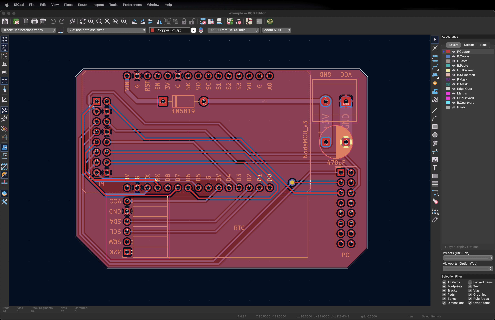

KP's rules tell KiCad what the laser and the CNC can make. Load them before you start a board, and keep the limits below in mind while you draw.

## Load the rules

1. Open the board in KiCad.
2. Go to **File › Board Setup… › Import Settings from Another Board…**
3. Pick `KiCAD_Custom_DRC_Rules_KPPCB.kicad_pcb` from the [`KiCAD_Custom_DRC_Rules_for_KPPCB`](https://github.com/kpkrisnop/PCB-Fiber-Laser-Fabrication-Instruction/tree/main/KiCAD_Custom_DRC_Rules_for_KPPCB) folder.
4. Click **Select All**, then **Import Settings**.

## Limits

**Holes:** the drill bits go from **0.6 to 1.5 mm in 0.1 mm steps**. Every hole is rounded to the nearest bit, so draw holes in that range and on those sizes.

| Rule | Set in the rules now | What the machines can do |
| --- | --- | --- |
| Smallest hole | 0.3 mm | **0.6 mm** (smallest bit) |
| Largest hole | not set | **1.5 mm** (largest bit) |
| Copper to copper | 0.3 mm | to check |
| Smallest track | not set (0) | to check |
| Copper to board edge | 0.3 mm | to check |
| Hole to hole | 0.25 mm | to check |
| Smallest via | 0.5 mm wide, 0.3 mm hole | hole must be ≥ 0.6 mm |
| Silkscreen text | 0.8 mm tall, 0.08 mm thick | to check |

:::caution[The rules don't catch small holes yet]
The rules still allow 0.3 mm holes and vias, so DRC passes a hole the CNC can't drill. Until the rules are fixed, check hole sizes by eye.
:::

:::note[To write]
- Tighten the rules to match the bits (hole 0.6–1.5 mm, via hole ≥ 0.6 mm) and the laser.
- Fill in "to check" with the real laser and CNC limits.
:::
