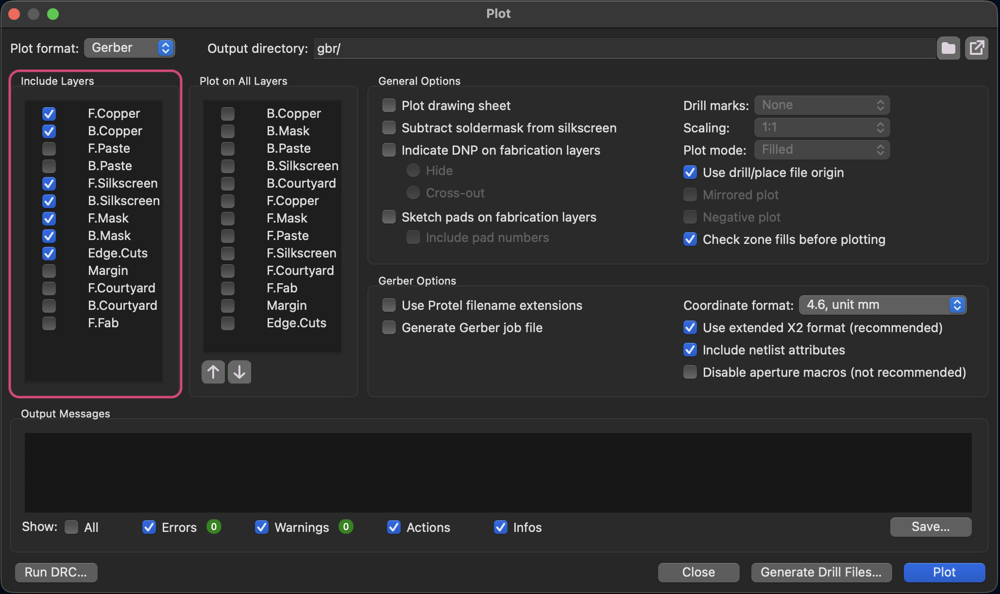
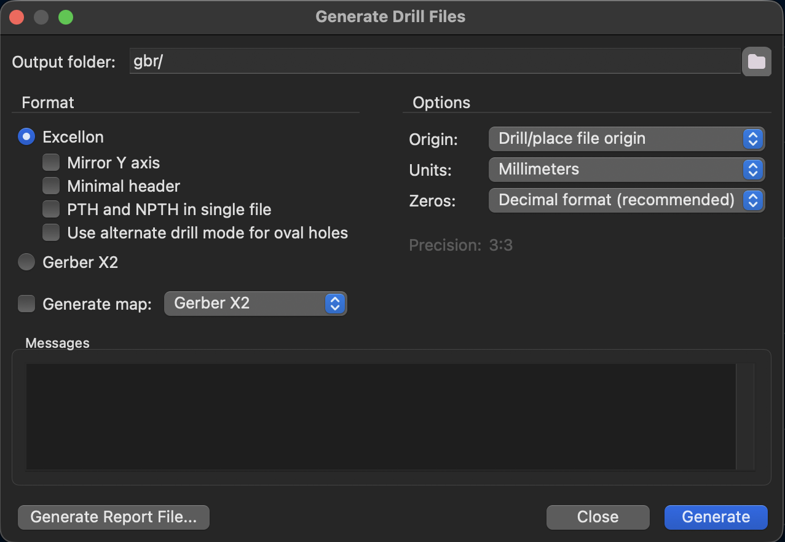

Export everything into a `gbr/` folder next to the board. Preparing reads that folder.

## Gerbers

Go to **File › Plot…**, set **Plot format** to **Gerber** and **Output directory** to `gbr/`.

**Layers:** tick every layer. Preparing only uses these seven, and the extra files do no harm:

`F.Cu` · `B.Cu` · `F.Mask` · `B.Mask` · `F.Silkscreen` · `B.Silkscreen` · `Edge.Cuts`

### Settings

| Setting | Set to | Why |
| --- | --- | --- |
| Plot drawing sheet | ☐ off | Draws a page frame onto the copper. |
| Subtract soldermask from silkscreen | ☑ on | Keeps silkscreen off the pads. *Suggested, not tested on the laser.* |
| Indicate DNP / Sketch pads on fab layers | leave | Fab layers only. Not used. |
| Drill marks, Scaling, Plot mode | leave | Greyed out for Gerber. |
| **Use drill/place file origin** | **same as the drill file** | Gerbers and drill file must use the same origin, or the holes miss the pads. |
| Mirrored plot, Negative plot | leave | Greyed out for Gerber. |
| Check zone fills before plotting | ☑ on | Stale copper pours give wrong copper. |
| **Use Protel filename extensions** | **☐ off** | Preparing looks for `<board>-Edge_Cuts.gbr`. Protel names (`.gm1`, `.gtl`) are not found. |
| Generate Gerber job file | ☐ off | Not used. |
| Coordinate format | 4.6, mm | Default. |
| Use extended X2 format | ☑ on | Default. FlatCAM reads it. |
| Include netlist attributes | ☑ on | Default. Ignored by FlatCAM. |
| Disable aperture macros | ☐ off | Default. FlatCAM reads macros. |

Click **Plot**.

## Drill file

Click **Generate Drill Files…**, output folder `gbr/`.

| Setting | Set to | Why |
| --- | --- | --- |
| Format | Excellon | |
| Mirror Y axis | ☐ off | |
| Minimal header | ☐ off | |
| **PTH and NPTH in single file** | **☑ on** | Preparing reads one `<board>.drl`. With this off you get two files and it stops. |
| Use alternate drill mode for oval holes | leave | Avoid oval holes. The CNC only drills round ones. |
| Generate map | ☐ off | Not used. |
| **Origin** | **same as the Gerbers** | Drill/place file origin if the Gerbers use it. |
| **Units** | **Millimeters** | Preparing refuses inch files. |
| Zeros | Decimal format | Default. |

:::caution[The screenshot is out of date]
It shows **PTH and NPTH in single file** off. Turn it on.
:::

Click **Generate**.

:::note[To write]
- New screenshots from KiCad 10. The command-line exporter in KiCad 10.0.7 has the same options; the dialogs haven't been compared yet.
- Check "Subtract soldermask from silkscreen" on a real board.
:::
